

  

  
  
  
  

  

## ⚡ Specialization & Expertise

- 4+ years of pre-sales engineering experience in Public Cloud services and Cloud Native technologies.
- Advanced knowledge of Observability, SRE, DevOps, Platform Engineering and tools of them.
- Expert skills of public clouds(30+ Cloud Certs)

  

## 🛠️ Tech stack

  
  
  
  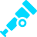
  
  

  

## 📊 Stats

  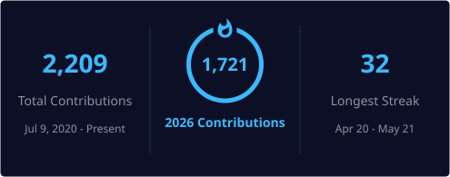

  

  

## 🐍 Contribution snake

  <picture>
    <source media="(prefers-color-scheme: dark)" srcset="https://raw.githubusercontent.com/AoTo0330/AoTo0330/output/github-contribution-grid-snake-dark.svg" />
    <source media="(prefers-color-scheme: light)" srcset="https://raw.githubusercontent.com/AoTo0330/AoTo0330/output/github-contribution-grid-snake.svg" />
    
  </picture>

  

## 📝 Latest posts

### [AoToLog](https://www.aotolog.com/)

<!-- AOTOLOG-POST-LIST:START -->
<a href="https://speakerdeck.com/aoto/designing-ai-agent-experiences-that-enhance-observability">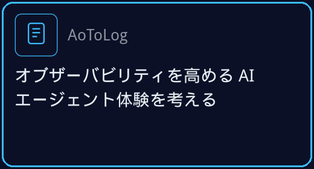</a>
<a href="https://www.datadoghq.com/ja/blog/datadog-live-tokyo-2026-recap-agent-observability/">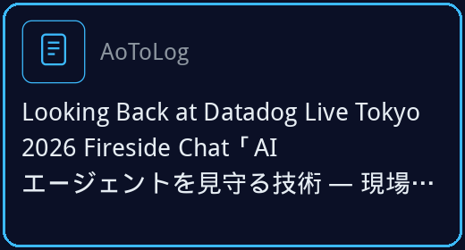</a>
<a href="https://www.datadoghq.com/ja/blog/datadog-live-tokyo-2025-observability-practices-panel/">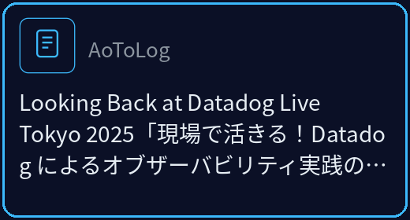</a>
<!-- AOTOLOG-POST-LIST:END -->

<a href="https://www.aotolog.com/">more on AoToLog →</a>

### [Zenn](https://zenn.dev/aotolog)

<!-- ZENN-POST-LIST:START -->
<a href="https://zenn.dev/datadog/articles/datadog-cr-tf">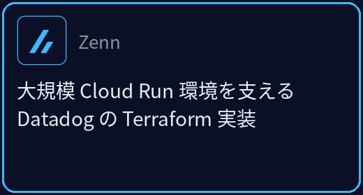</a>
<a href="https://zenn.dev/datadog/articles/bits-ai-sre-intro">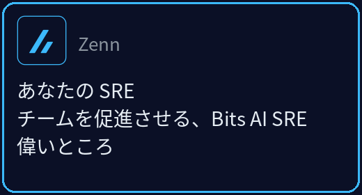</a>
<a href="https://zenn.dev/datadog/articles/datadog-gc-logs-dataflow">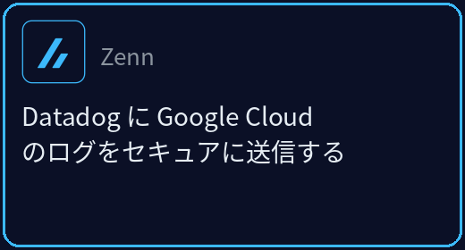</a>
<!-- ZENN-POST-LIST:END -->

<a href="https://zenn.dev/aotolog">more on Zenn →</a>

### [Qiita](https://qiita.com/aoto0330)

<!-- QIITA-POST-LIST:START -->
<a href="https://qiita.com/AoTo0330/items/0ce1505b5a1b2d080ad8">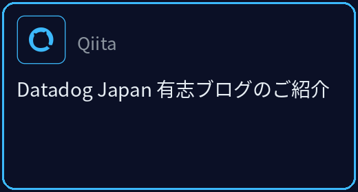</a>
<a href="https://qiita.com/AoTo0330/items/8eb5beef716a3b1eca49">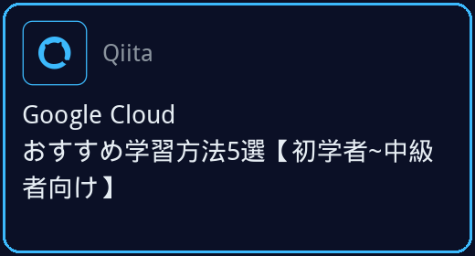</a>
<a href="https://qiita.com/AoTo0330/items/36727475de42eab1fa7e">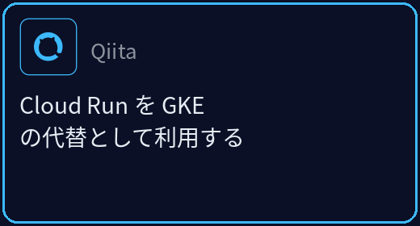</a>
<!-- QIITA-POST-LIST:END -->

<a href="https://qiita.com/aoto0330">more on Qiita →</a>

  

## 🏆 Awards & Recognitions

### AWS

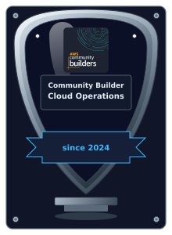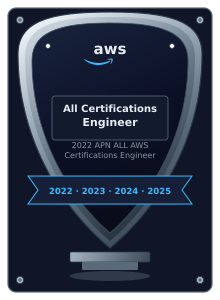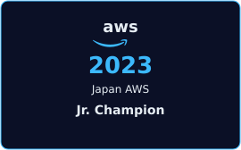 

### Google Cloud

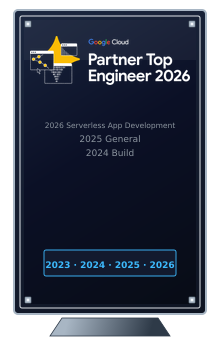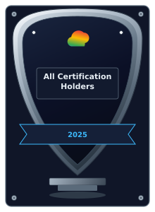 

### Jagu'e'r

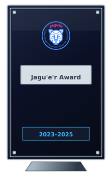 

  

## 🎤 Talks

<a href="https://speakerdeck.com/aoto/powering-reliable-agentic-ai-with-datadog-observability">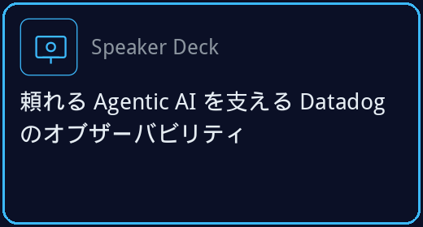</a>
<a href="https://speakerdeck.com/aoto/building-ai-agents-with-ai-agents-by-google-cloud">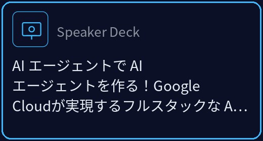</a>
<a href="https://speakerdeck.com/aoto/beyond-the-field-barriers-instrumentation-injection-and-the-future-of-observability">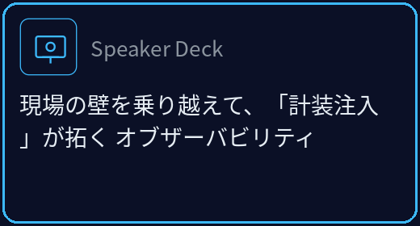</a>

<a href="https://speakerdeck.com/aoto">more on Speaker Deck →</a>

## 📬 Contact

  

  

