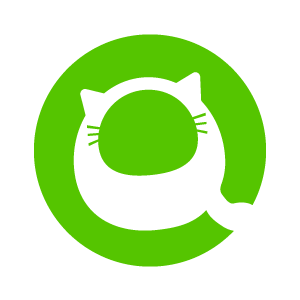

  

  
  
  

  

  

# ⚡ Overview

Datadog 🐶 -  Enterprise Sales Engineer

### Specialization & Expertise

- 4+ years of pre-sales engineering experience in Public Cloud services and Cloud Native technologies.
- Advanced knowledge of Observability, SRE, DevOps, Platform Engineering and tools of them.
- Expert skills of public clouds(30+ Cloud Certs)

  

## 🛠️ Tech stack

  
  
  
  
  
  

  

## 📊 Stats

  

  

  

## 🐍 Contribution snake

  <picture>
    <source media="(prefers-color-scheme: dark)" srcset="https://raw.githubusercontent.com/AoTo0330/AoTo0330/output/github-contribution-grid-snake-dark.svg" />
    <source media="(prefers-color-scheme: light)" srcset="https://raw.githubusercontent.com/AoTo0330/AoTo0330/output/github-contribution-grid-snake.svg" />
    
  </picture>

  

## 📝 Latest posts

### [AoToLog](https://www.aotolog.com/)

<!-- AOTOLOG-POST-LIST:START -->
- [オブザーバビリティを高める AI エージェント体験を考える](https://speakerdeck.com/aoto/designing-ai-agent-experiences-that-enhance-observability)
- [Looking Back at Datadog Live Tokyo 2026 Fireside Chat「AI エージェントを見守る技術 ― 現場から考える Agent Observability」開催レポート](https://www.datadoghq.com/ja/blog/datadog-live-tokyo-2026-recap-agent-observability/)
- [Looking Back at Datadog Live Tokyo 2025「現場で活きる！Datadog によるオブザーバビリティ実践のリアル」パネルディスカッション開催レポート](https://www.datadoghq.com/ja/blog/datadog-live-tokyo-2025-observability-practices-panel/)
- [2026 Japan All AWS Certifications Engineer](https://aws.amazon.com/jp/blogs/psa/2026-japan-all-aws-certifications-engineers/)
- [生成 AI の成果物を他人に共有するな](https://sizu.me/aoto/posts/zaxeccmrcmzx)
<!-- AOTOLOG-POST-LIST:END -->

### [Zenn](https://zenn.dev/aotolog)

<!-- ZENN-POST-LIST:START -->
- [大規模 Cloud Run 環境を支える Datadog の Terraform 実装](https://zenn.dev/datadog/articles/datadog-cr-tf)
- [あなたの SRE チームを促進させる、Bits AI SRE 偉いところ](https://zenn.dev/datadog/articles/bits-ai-sre-intro)
- [Datadog に Google Cloud のログをセキュアに送信する](https://zenn.dev/datadog/articles/datadog-gc-logs-dataflow)
- [Cloud Run で GMP を利用する際の注意点](https://zenn.dev/aotolog/articles/cr-gmp-notes)
- [Next.js に Datadog APM を導入する際の注意点](https://zenn.dev/datadog/articles/nextjs-datadog-apm)
<!-- ZENN-POST-LIST:END -->

### [Qiita](https://qiita.com/aoto0330)

<!-- QIITA-POST-LIST:START -->
- [Datadog Japan 有志ブログのご紹介](https://qiita.com/AoTo0330/items/0ce1505b5a1b2d080ad8)
- [Google Cloud おすすめ学習方法5選【初学者~中級者向け】](https://qiita.com/AoTo0330/items/8eb5beef716a3b1eca49)
- [Cloud Run を GKE の代替として利用する](https://qiita.com/AoTo0330/items/36727475de42eab1fa7e)
- [マルチステージビルドを完全に理解して Cloud Run のセキュリティを向上する](https://qiita.com/AoTo0330/items/4d2c0fa6a127ef5b4b1d)
<!-- QIITA-POST-LIST:END -->

  

## 🏆 Awards & Recognitions

🏆 Awards & Recognitions

- [AWS Community Builder - Cloud Operations, since 2024](https://aws.amazon.com/jp/developer/community/community-builders/community-builders-directory/?cb-cards.q=kento%2Bkimura)
- [2025 Japan All AWS Certifications Engineer](https://aws.amazon.com/jp/blogs/psa/2025-japan-all-aws-certifications-engineers/)
- [2024 Japan AWS All Certifications Engineer](https://aws.amazon.com/jp/blogs/psa/2024-japan-aws-all-certifications-engineers/)
- [2023 Japan AWS All Certifications Engineer](https://aws.amazon.com/jp/blogs/psa/2023-japan-aws-all-certifications-engineers/)
- [2022 APN ALL AWS Certifications Engineer](https://aws.amazon.com/jp/blogs/psa/2022-apn-all-aws-certifications-engineers/)
- [2023 Japan AWS Jr. Champion](https://aws.amazon.com/jp/blogs/psa/2023-japan-aws-jr-champions/)
- [Google Cloud Partner Top Engineer 2026(Serverless App Development)](https://cloud.google.com/blog/ja/topics/partners/announcing-the-winners-of-the-google-cloud-partner-top-engineer-2026-award-program?hl=ja)
- [Google Cloud Partner Top Engineer 2025(General)](https://cloud.google.com/blog/ja/topics/partners/partner-top-engineer-2025-award-winners?hl=ja)
- [Google Cloud Partner Top Engineer 2024(Build)](https://cloud.google.com/blog/ja/topics/partners/partner-top-engineer-2024-award-winners?hl=ja)
- [Google Cloud Partner Top Engineer 2023](https://cloud.google.com/blog/ja/topics/partners/partner-top-engineer-2023-award-winners?hl=ja)
- [Google Cloud Partner All Certification Holders 2025](https://cloud.google.com/blog/ja/topics/partners/google-cloud-partner-all-certification-holders-2025?hl=ja)
- Jagu'e'r Award 2025 - Grand Prize
- Jagu'e'r Award 2024 - Excellent Award
- [Jagu'e'r Award 2023 - Excellent Award](https://jaguer.jp/jaguer_park_23_winter/)

  

## 🎤 Talks

- [頼れる Agentic AI を支える Datadog のオブザーバビリティ](https://speakerdeck.com/aoto/powering-reliable-agentic-ai-with-datadog-observability)
- [AI エージェントで AI エージェントを作る！Google Cloudが実現するフルスタックな AI 開発エコシステム](https://speakerdeck.com/aoto/building-ai-agents-with-ai-agents-by-google-cloud)
- [現場の壁を乗り越えて、「計装注入」が拓く オブザーバビリティ](https://speakerdeck.com/aoto/beyond-the-field-barriers-instrumentation-injection-and-the-future-of-observability)
- [もっと！スタートアップ創業期を支えるオブザーバビリティ基盤のこれまでとこれから](https://speakerdeck.com/aoto/more-the-past-and-future-of-observability-platforms-supporting-early-stage-startups)

and more → [Speaker Deck](https://speakerdeck.com/aoto)

  

## 🔗 Social link

## 📬 Contact

- [aoto@datadoghq.com](mailto:aoto@datadoghq.com)

  

