

  <picture>
    <source media="(prefers-color-scheme: dark)" srcset="https://readme-typing-svg.demolab.com?font=Fira+Code&weight=600&size=22&duration=3000&pause=1000&color=3CB9FC&center=true&vCenter=true&width=640&height=50&lines=Datadog+%F0%9F%90%B6+-+Enterprise+Sales+Engineer" />
    <source media="(prefers-color-scheme: light)" srcset="https://readme-typing-svg.demolab.com?font=Fira+Code&weight=600&size=22&duration=3000&pause=1000&color=0B1F3A&center=true&vCenter=true&width=640&height=50&lines=Datadog+%F0%9F%90%B6+-+Enterprise+Sales+Engineer" />
    
  </picture>

  <a href="https://zenn.dev/aotolog"><picture><source media="(prefers-color-scheme: dark)" srcset="./public/images/badges/zenn-likes.svg" /><source media="(prefers-color-scheme: light)" srcset="./public/images/badges/zenn-likes-light.svg" /></picture></a>
  <a href="https://qiita.com/aoto0330"><picture><source media="(prefers-color-scheme: dark)" srcset="./public/images/badges/qiita-contributions.svg" /><source media="(prefers-color-scheme: light)" srcset="./public/images/badges/qiita-contributions-light.svg" /></picture></a>
  <a href="https://speakerdeck.com/aoto"><picture><source media="(prefers-color-scheme: dark)" srcset="./public/images/badges/speakerdeck-views.svg" /><source media="(prefers-color-scheme: light)" srcset="./public/images/badges/speakerdeck-views-light.svg" /></picture></a>
  

## ⚡ Specialization & Expertise

- 4+ years of pre-sales engineering experience in Public Cloud services and Cloud Native technologies.
- Advanced knowledge of Observability, SRE, DevOps, Platform Engineering and tools of them.
- Expert skills of public clouds(30+ Cloud Certs)

## 📊 Stats

  <picture>
    <source media="(prefers-color-scheme: dark)" srcset="./public/images/badges/github-contrib-stats.svg" />
    <source media="(prefers-color-scheme: light)" srcset="./public/images/badges/github-contrib-stats-light.svg" />
    
  </picture>

  <picture>
    <source media="(prefers-color-scheme: dark)" srcset="https://github-act-graph.rodriaum.com/graph?username=AoTo0330&bg_color=0b1026&color=8b949e&line=3cb9fc&point=3cb9fc&hide_border=true" />
    <source media="(prefers-color-scheme: light)" srcset="https://github-act-graph.rodriaum.com/graph?username=AoTo0330&bg_color=f6f8fa&color=57606a&line=3cb9fc&point=3cb9fc&hide_border=true" />
    
  </picture>

## 🏆 Awards & Recognitions

<h3 align="center">AWS</h3>

<a href="https://aws.amazon.com/jp/developer/community/community-builders/community-builders-directory/?cb-cards.q=kento%2Bkimura"><picture><source media="(prefers-color-scheme: dark)" srcset="./public/images/awards/aws-community-builder.png" /><source media="(prefers-color-scheme: light)" srcset="./public/images/awards/aws-community-builder-light.png" />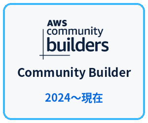</picture></a>
<a href="https://aws.amazon.com/jp/blogs/psa/2025-japan-all-aws-certifications-engineers/"><picture><source media="(prefers-color-scheme: dark)" srcset="./public/images/awards/aws-allcerts.png" /><source media="(prefers-color-scheme: light)" srcset="./public/images/awards/aws-allcerts-light.png" />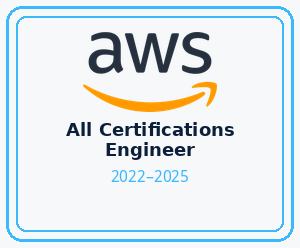</picture></a>
<a href="https://aws.amazon.com/jp/blogs/psa/2023-japan-aws-jr-champions/"><picture><source media="(prefers-color-scheme: dark)" srcset="./public/images/awards/aws-jr-champion-2023.png" /><source media="(prefers-color-scheme: light)" srcset="./public/images/awards/aws-jr-champion-2023-light.png" />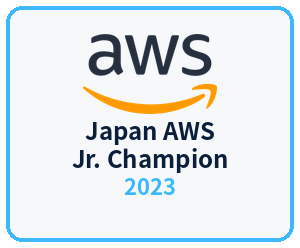</picture></a>

Community Builder（Cloud Operations）：<a href="https://aws.amazon.com/jp/developer/community/community-builders/community-builders-directory/?cb-cards.q=kento%2Bkimura">2024～現在</a> 
All Certifications Engineer：<a href="https://aws.amazon.com/jp/blogs/psa/2022-apn-all-aws-certifications-engineers/">2022</a>&nbsp;·&nbsp;<a href="https://aws.amazon.com/jp/blogs/psa/2023-japan-aws-all-certifications-engineers/">2023</a>&nbsp;·&nbsp;<a href="https://aws.amazon.com/jp/blogs/psa/2024-japan-aws-all-certifications-engineers/">2024</a>&nbsp;·&nbsp;<a href="https://aws.amazon.com/jp/blogs/psa/2025-japan-all-aws-certifications-engineers/">2025</a> 
Jr. Champion：<a href="https://aws.amazon.com/jp/blogs/psa/2023-japan-aws-jr-champions/">2023</a>

<h3 align="center">Google Cloud</h3>

<a href="https://cloud.google.com/blog/ja/topics/partners/announcing-the-winners-of-the-google-cloud-partner-top-engineer-2026-award-program?hl=ja"><picture><source media="(prefers-color-scheme: dark)" srcset="./public/images/awards/gcp-pte.png" /><source media="(prefers-color-scheme: light)" srcset="./public/images/awards/gcp-pte-light.png" />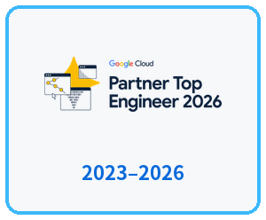</picture></a>
<a href="https://cloud.google.com/blog/ja/topics/partners/google-cloud-partner-all-certification-holders-2025?hl=ja"><picture><source media="(prefers-color-scheme: dark)" srcset="./public/images/awards/gcp-all-cert-holders-2025.png" /><source media="(prefers-color-scheme: light)" srcset="./public/images/awards/gcp-all-cert-holders-2025-light.png" />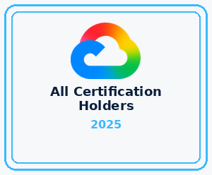</picture></a>
<picture><source media="(prefers-color-scheme: dark)" srcset="./public/images/awards/jaguer.png" /><source media="(prefers-color-scheme: light)" srcset="./public/images/awards/jaguer-light.png" />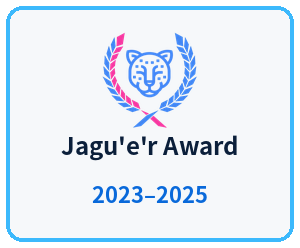</picture>

Partner Top Engineer：<a href="https://cloud.google.com/blog/ja/topics/partners/partner-top-engineer-2023-award-winners?hl=ja">2023</a>&nbsp;·&nbsp;<a href="https://cloud.google.com/blog/ja/topics/partners/partner-top-engineer-2024-award-winners?hl=ja">2024</a>&nbsp;·&nbsp;<a href="https://cloud.google.com/blog/ja/topics/partners/partner-top-engineer-2025-award-winners?hl=ja">2025</a>（Build / General）·&nbsp;<a href="https://cloud.google.com/blog/ja/topics/partners/announcing-the-winners-of-the-google-cloud-partner-top-engineer-2026-award-program?hl=ja">2026</a>（Serverless） 
All Certification Holders：<a href="https://cloud.google.com/blog/ja/topics/partners/google-cloud-partner-all-certification-holders-2025?hl=ja">2025</a> 
Jagu'e'r Award：2023&nbsp;·&nbsp;2024<wbr>（Excellent）·&nbsp;<wbr>2025&#8288;（Grand&nbsp;Prize）

## 🛠️ Tech stack

  <picture>
    <source media="(prefers-color-scheme: dark)" srcset="./public/images/tech/aws-dark.png" />
    <source media="(prefers-color-scheme: light)" srcset="./public/images/tech/aws.png" />
    
  </picture>
  
  
  
  
  <picture>
    <source media="(prefers-color-scheme: dark)" srcset="./public/images/tech/datadog-dark.svg" />
    <source media="(prefers-color-scheme: light)" srcset="./public/images/tech/datadog.svg" />
    
  </picture>

## 🐍 Contribution snake

  <picture>
    <source media="(prefers-color-scheme: dark)" srcset="https://raw.githubusercontent.com/AoTo0330/AoTo0330/output/github-contribution-grid-snake-dark.svg" />
    <source media="(prefers-color-scheme: light)" srcset="https://raw.githubusercontent.com/AoTo0330/AoTo0330/output/github-contribution-grid-snake.svg" />
    
  </picture>

## 📝 Latest posts

### AoToLog

<!-- AOTOLOG-POST-LIST:START -->
<a href="https://speakerdeck.com/aoto/designing-ai-agent-experiences-that-enhance-observability"><picture><source media="(prefers-color-scheme: dark)" srcset="./public/images/posts/aotolog-1.png" /><source media="(prefers-color-scheme: light)" srcset="./public/images/posts/aotolog-1-light.png" />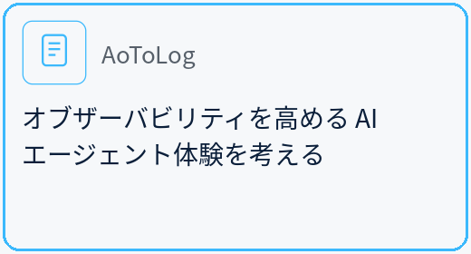</picture></a>
<a href="https://www.datadoghq.com/ja/blog/datadog-live-tokyo-2026-recap-agent-observability/"><picture><source media="(prefers-color-scheme: dark)" srcset="./public/images/posts/aotolog-2.png" /><source media="(prefers-color-scheme: light)" srcset="./public/images/posts/aotolog-2-light.png" />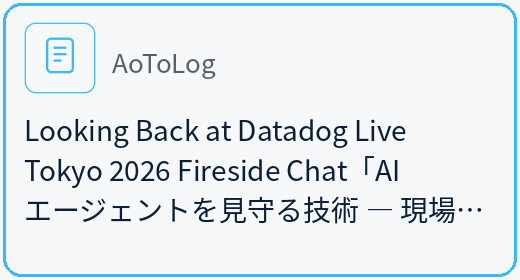</picture></a>
<a href="https://www.datadoghq.com/ja/blog/datadog-live-tokyo-2025-observability-practices-panel/"><picture><source media="(prefers-color-scheme: dark)" srcset="./public/images/posts/aotolog-3.png" /><source media="(prefers-color-scheme: light)" srcset="./public/images/posts/aotolog-3-light.png" />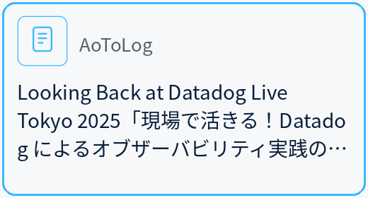</picture></a>
<!-- AOTOLOG-POST-LIST:END -->

<a href="https://www.aotolog.com/">more on AoToLog →</a>

### Zenn

<!-- ZENN-POST-LIST:START -->
<a href="https://zenn.dev/datadog/articles/datadog-cr-tf"><picture><source media="(prefers-color-scheme: dark)" srcset="./public/images/posts/zenn-1.png" /><source media="(prefers-color-scheme: light)" srcset="./public/images/posts/zenn-1-light.png" />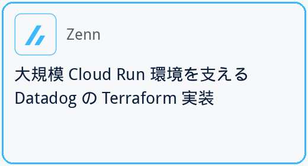</picture></a>
<a href="https://zenn.dev/datadog/articles/bits-ai-sre-intro"><picture><source media="(prefers-color-scheme: dark)" srcset="./public/images/posts/zenn-2.png" /><source media="(prefers-color-scheme: light)" srcset="./public/images/posts/zenn-2-light.png" />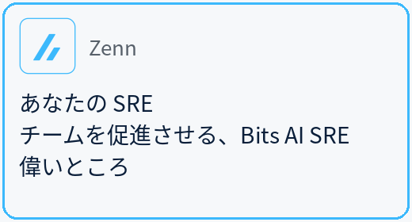</picture></a>
<a href="https://zenn.dev/datadog/articles/datadog-gc-logs-dataflow"><picture><source media="(prefers-color-scheme: dark)" srcset="./public/images/posts/zenn-3.png" /><source media="(prefers-color-scheme: light)" srcset="./public/images/posts/zenn-3-light.png" />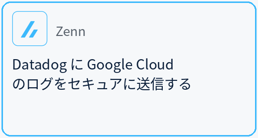</picture></a>
<!-- ZENN-POST-LIST:END -->

<a href="https://zenn.dev/aotolog">more on Zenn →</a>

### Qiita

<!-- QIITA-POST-LIST:START -->
<a href="https://qiita.com/AoTo0330/items/0ce1505b5a1b2d080ad8"><picture><source media="(prefers-color-scheme: dark)" srcset="./public/images/posts/qiita-1.png" /><source media="(prefers-color-scheme: light)" srcset="./public/images/posts/qiita-1-light.png" />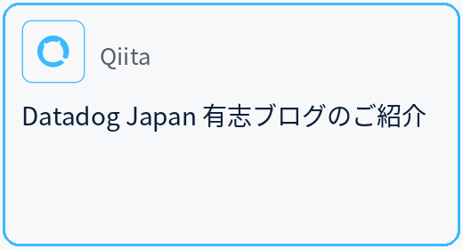</picture></a>
<a href="https://qiita.com/AoTo0330/items/8eb5beef716a3b1eca49"><picture><source media="(prefers-color-scheme: dark)" srcset="./public/images/posts/qiita-2.png" /><source media="(prefers-color-scheme: light)" srcset="./public/images/posts/qiita-2-light.png" />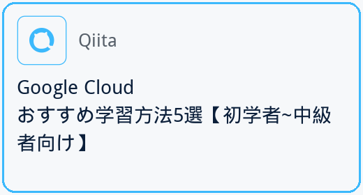</picture></a>
<a href="https://qiita.com/AoTo0330/items/36727475de42eab1fa7e"><picture><source media="(prefers-color-scheme: dark)" srcset="./public/images/posts/qiita-3.png" /><source media="(prefers-color-scheme: light)" srcset="./public/images/posts/qiita-3-light.png" />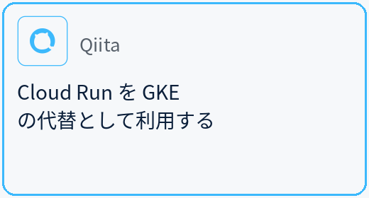</picture></a>
<!-- QIITA-POST-LIST:END -->

<a href="https://qiita.com/aoto0330">more on Qiita →</a>

## 🎤 Talks

<a href="https://speakerdeck.com/aoto/powering-reliable-agentic-ai-with-datadog-observability"><picture><source media="(prefers-color-scheme: dark)" srcset="./public/images/talks/talk-1.png" /><source media="(prefers-color-scheme: light)" srcset="./public/images/talks/talk-1-light.png" />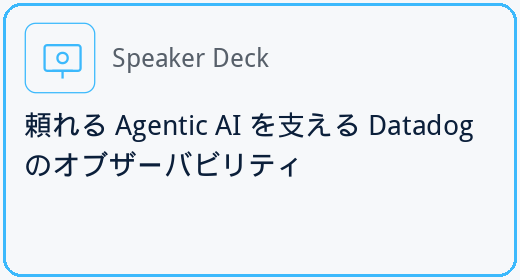</picture></a>
<a href="https://speakerdeck.com/aoto/building-ai-agents-with-ai-agents-by-google-cloud"><picture><source media="(prefers-color-scheme: dark)" srcset="./public/images/talks/talk-2.png" /><source media="(prefers-color-scheme: light)" srcset="./public/images/talks/talk-2-light.png" />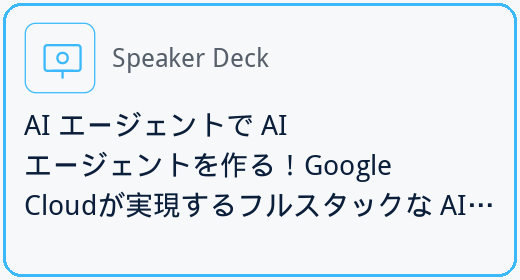</picture></a>
<a href="https://speakerdeck.com/aoto/beyond-the-field-barriers-instrumentation-injection-and-the-future-of-observability"><picture><source media="(prefers-color-scheme: dark)" srcset="./public/images/talks/talk-3.png" /><source media="(prefers-color-scheme: light)" srcset="./public/images/talks/talk-3-light.png" />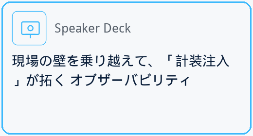</picture></a>

<a href="https://speakerdeck.com/aoto">more on Speaker Deck →</a>

## 📬 Contact

  <a href="mailto:aoto@datadoghq.com"><picture><source media="(prefers-color-scheme: dark)" srcset="./public/images/contact/mail.svg" /><source media="(prefers-color-scheme: light)" srcset="./public/images/contact/mail-light.svg" /></picture></a>

  <picture>
    <source media="(prefers-color-scheme: dark)" srcset="https://capsule-render.vercel.app/api?type=waving&height=90&section=footer&color=0b1026" />
    <source media="(prefers-color-scheme: light)" srcset="https://capsule-render.vercel.app/api?type=waving&height=90&section=footer&color=f6f8fa" />
    
  </picture>

